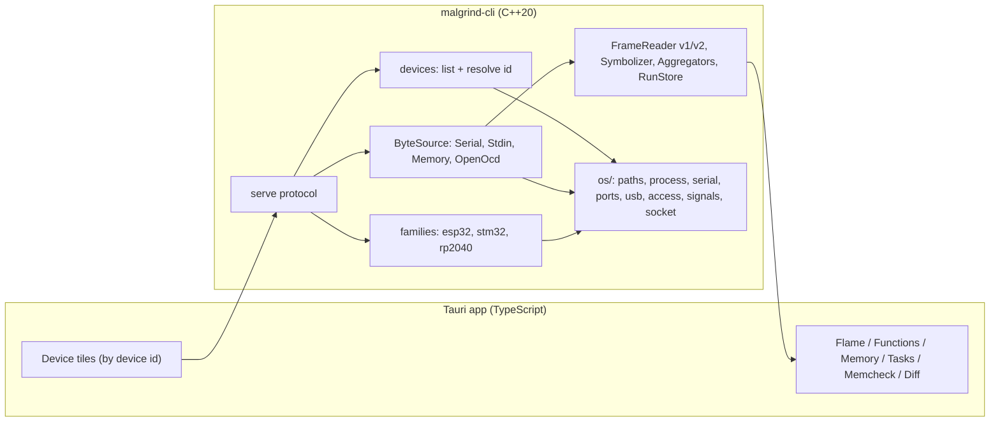
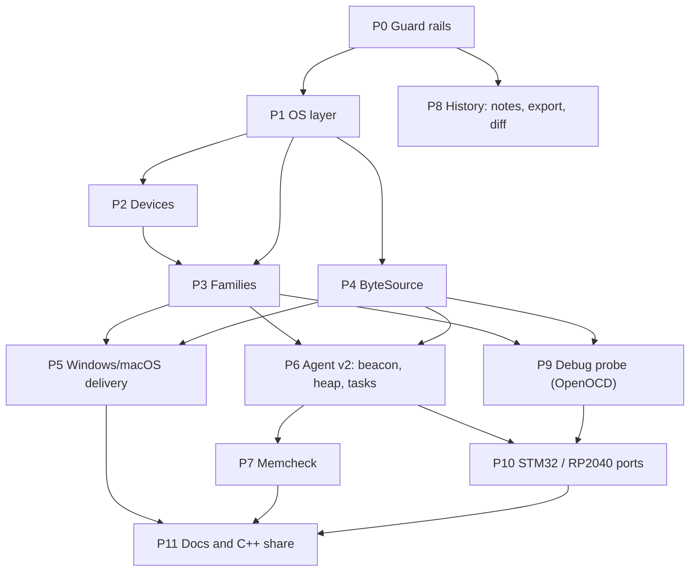

# malgrind Stage 2+ Implementation Plan: everything still planned, cross-platform and device-agnostic

> **For agentic workers.** Execute one task at a time, in the order of section 5. Every task lists what to read, which
> files to touch, the exact interfaces, numbered steps with checkboxes, the commands that prove it works, and what
> "done" means. Do not start a task whose dependencies are not merged. Do not invent interfaces that this plan already
> names; if a named interface cannot work, **stop and report** instead of improvising. Tasks marked 🔌 need a real board
> or probe: do the code part, then stop and hand the hardware check to the human. Tasks marked 🔴 are spikes or hard
> tasks: give them to the strongest available agent or to the human.

**Goal.** Finish everything the spec and README still list as planned (debug probe, agent v2 with heap/tasks, memcheck,
diff, export, notes, more MCUs, macOS check) and, before any of it, make the engine **cross-platform (Linux, macOS,
Windows)** and **device-agnostic**: choosing a board works the same on every OS and for every chip family, and no code
outside two well-fenced places knows about a particular OS or a particular chip.

**Spec:** `docs/superpowers/specs/2026-11-15-malgrind-app-design.md`. This plan changes the spec in two places (Windows
becomes a goal; "device" and "family" become first-class concepts). Task T0.3 writes those changes into the spec.

**Tech stack (unchanged unless named):** C++20, CMake ≥ 3.20, nlohmann_json 3.11.3, Tauri 2, Svelte 5, TypeScript 5.9,
Vitest, d3-flame-graph 4.1.3, PlatformIO. New: MSVC 2022 (17.8+) on Windows; `uplot` 1.6.31 (P6); OpenOCD from PlatformIO
packages (P9).

---

## 1. What is still planned (inventory)

Collected from README "Status" and "Limits", spec sections 2, 5, 5a, 7, 8, 12, and `platforms/stm32/README.md`.

| # | Item | Source | Phase |
|---|---|---|---|
| 1 | Windows support (was a non-goal; required now) | user request 2026-11-18 | P0, P1, P5 |
| 2 | Platform-independent device selection (no `/dev/tty*`, no chip assumptions in UI/engine core) | user request 2026-11-18 | P2, P3 |
| 3 | macOS: real port enumeration with USB info (today only names), real-hardware check of the `.dmg` | README Status | P1 (T1.4), P5 (T5.4) |
| 4 | `Source` becomes an interface when a second source exists | spec 5a | P4 |
| 5 | Agent v2: hello beacon, sleep, start/stop, heap stats, FreeRTOS task stats; Memory and Tasks tabs | spec 5, 7, 12.4 | P6 |
| 6 | Allocation hooks, error events, Memcheck tab, "Check memory errors" build option | spec 5, 7, 12.5 | P7 |
| 7 | Run notes editing (engine has `update {notes}`, UI has no editor) | spec 8 | P8 |
| 8 | Export: folded stacks, speedscope JSON, PNG/SVG of the view | spec 8 | P8 |
| 9 | Diff of two runs (by function name) | spec 8 | P8 |
| 10 | Storage size warning | spec 8 | P8 |
| 11 | ESP32 ROM function names (`0x4000xxxx` show raw) | README "ESP32 notes" | P8 (optional T8.6) |
| 12 | Debug probe via OpenOCD: Cortex-M first (DWT_PCSR), then ESP32 over JTAG | spec 5a, 12.3 | P9 |
| 13 | STM32 / RP2040 agent ports | README Status, `platforms/stm32/README.md` | P10 |
| 14 | Functions view time-series strip (uPlot) | spec 7, 10 | P6 (T6.6) |
| 15 | README, C++ share check (≥ 60 %) | spec 10, 12.6 | P11 |
| 16 | Unverified: drag and drop, real `pkexec` prompt, "Flash this board" button | README Status | P5 (T5.4 checklist) |

---

## 2. Decisions this plan takes (the user may veto before P1 starts)

1. **Windows is supported** (x86-64, Windows 10 1809+ / 11), built with **MSVC**, packaged by Tauri as an NSIS `.exe`
   installer. The spec's non-goal "Windows" is removed (T0.3).
2. **One OS layer.** Every OS-specific call lives in `host/src/os/`. Outside it: no `#ifdef _WIN32/__APPLE__/__linux__`,
   no `<unistd.h>`, `<windows.h>`, `/dev/`, `/sys/`, `errno`, `getenv`. A checker script enforces it (T0.1).
3. **Devices, not ports.** The UI and the protocol select a **device** by a stable, OS-neutral **device id**
   (`usb-1a86-7523-sn-5A7B0123`), never by parsing a path. The engine resolves the id to the current OS path
   (`/dev/ttyUSB0`, `/dev/cu.usbserial-1410`, `COM5`) at the moment it opens it, and again after an upload.
4. **Families, not ESP32.** Everything chip-specific (which PlatformIO platforms/frameworks are supported, how the agent
   is injected, how the flash is backed up and restored, how the chip is identified, the agent's baud rate, addr2line
   names, OpenOCD configs) sits behind one C++ interface `Family` in `host/src/families/`. ESP32 is the first
   implementation; STM32 and RP2040 are later files, not edits all over the engine.
5. **Plan language:** English, like the rest of `docs/`.
6. **Protocol compatibility:** the app is the only client of `serve`, so the protocol may change, but the app and the
   engine change **in the same task**. Stored runs stay readable forever (wire v1 frames and old `meta.json` load).

---

## 3. Global constraints (every task)

- C++20, not C++23: no `std::expected`, no `std::print`, no `views::zip`. GCC ≥ 13, Clang/libc++ ≥ 17, MSVC ≥ 17.8.
- `core/` stays freestanding (no heap, no exceptions, no iostream, no SDK). Wire magic `MLC1` and `Arch` values never change.
- All analysis is C++; TypeScript renders and forwards input. The UI never parses ports, paths or chip names.
- The serial port is opened exclusively; a busy port is reported, never shared.
- Never write inside the user's project except `<project>/.pio/malgrind/`.
- Paths: use `std::filesystem::path` inside the engine. Wherever a path becomes JSON, a log line or a process argument, use
  `os::to_utf8(path)`; wherever a string from JSON becomes a path, use `os::from_utf8(s)` (T1.1). Never `path.string()`
  across those boundaries (it is lossy on Windows).
- Child processes never get a shell. Never run `.bat`/`.cmd` files (Windows argument-injection class of bugs).
- Shared board: before every 🔌 step, check the port is free (Linux `fuser -v <port>`, macOS `lsof <port>`, Windows: close
  other serial monitors). If the user's own session holds it, stop and ask.
- Code style: match the file you edit (C++ 4 spaces, TS 2 spaces, lines ≤ 140, comments say *why*). Tests are plain
  `assert` programs registered with `malgrind_add_test` (T0.2).
- Commands every task runs before committing:
  ```
  cmake -B build -DCMAKE_BUILD_TYPE=Debug && cmake --build build -j && ctest --test-dir build --output-on-failure
  node scripts/check-portability.mjs
  cd app && pnpm test && pnpm check        # only if app/ changed
  ```
- One task = one commit (message given in the task). Branch per phase: `feat/p<N>-<name>`.

---

## 4. Target architecture



`os/` knows the OS and nothing about chips. `families/` knows chips and nothing about the OS (it calls `os/`).
Everything else knows neither.

---

## 5. Phases, order and parallelism



Recommended sequence: **P0 → P1 → (P2 ∥ P4 ∥ P8) → P3 → P5 → P6 → P7 → P9 → P10 → P11.**
Inside P1, T1.1 and T1.2 come first; T1.3–T1.8 may then run in parallel (separate files).

Legend: 🟢 simple (a small agent can do it from this text), 🟡 medium (needs care, still well specified), 🔴 hard or
spike, 🔌 needs hardware.

---

## P0. Guard rails

### T0.1 Portability checker 🟢

**Read first:** this section 3; `host/src/*.cpp` (grep only).

**Files:** Create `scripts/check-portability.mjs`, `scripts/portability-allow.json`, `scripts/check-portability.test.mjs`.
Modify `.github/workflows/ci.yml` (add a step to the `ui` job: `node scripts/check-portability.mjs` and
`node --test scripts/check-portability.test.mjs`).

**Interface:** `node scripts/check-portability.mjs` exits 0 when clean, 1 with `file:line: rule: text` per violation.
Two rule sets:

- `os` — scanned: `host/src/**/*.{cpp,hpp}` except `host/src/os/**`; `core/**`. Forbidden (regex, per line, comments included):
  `#\s*include\s*<(unistd|termios|fcntl|spawn|poll|pwd|grp|dlfcn|windows|winsock2|ws2tcpip|setupapi|cfgmgr32|shlobj|io)\.h>`,
  `#\s*include\s*<(sys|IOKit|CoreFoundation|mach-o|arpa|netinet)/`, `\b(_WIN32|__APPLE__|__linux__)\b`,
  `"/(dev|sys|proc)/`, `/bin/sh`, `\.local/share`, `Library/Application Support`, `\b(std::)?(getenv|setenv|unsetenv)\s*\(`, `\berrno\b`.
- `chip` — scanned: `host/src/**` except `host/src/families/**`; `app/src/**` except `*.test.ts`. Forbidden
  (case-insensitive): `\besp(32|tool|ressif|idf)\w*`, `xtensa-`, `sdkconfig`, `ttyUSB|ttyACM|/dev/|\bCOM\d`, `pkexec`,
  `\bsudo\b`, `apt install`.

`portability-allow.json` = `{ "os": ["host/src/source.cpp", ...], "chip": [...] }`: whole files temporarily allowed.
Generate it by running the checker once and listing every violating file. **Each later task removes the files it cleans
from this list**; P1 ends with `"os": []`, P3 ends with `"chip": []`.

- [x] 1. Write the test first: fixtures as strings, assert each rule fires and that allow-listed files and `os/` are skipped.
- [x] 2. Implement with `node:fs` recursive `readdirSync`, no dependencies.
- [x] 3. Run it, fill the allow list, run again: exit 0.
- [x] 4. Commit `chore: portability checker (os and chip rules) with a shrinking allow list`.

**Done when:** CI runs it; `node scripts/check-portability.mjs` is green on the current tree.

### T0.2 CMake that MSVC accepts 🟢

**Files:** `CMakeLists.txt`, `core/CMakeLists.txt`, `host/CMakeLists.txt`.

- [x] 1. Root: add `function(malgrind_add_test name)` that does `add_executable(test_${name} ${ARGN})`,
      `target_compile_options(test_${name} PRIVATE $<IF:$<CXX_COMPILER_ID:MSVC>,/UNDEBUG,-UNDEBUG>)`, `add_test(NAME ${name} COMMAND test_${name})`.
      Replace every hand-written test block in `core/` and `host/` with it (keep the `target_link_libraries` lines).
- [x] 2. Replace `-Wall -Wextra` with `$<IF:$<CXX_COMPILER_ID:MSVC>,/W3 /permissive- /Zc:__cplusplus /utf-8 /EHsc,-Wall -Wextra>`.
- [x] 3. `if(WIN32) add_compile_definitions(NOMINMAX WIN32_LEAN_AND_MEAN _WIN32_WINNT=0x0A00 UNICODE _UNICODE) endif()` in the root.
- [x] 4. Tests that need a POSIX pty or `#!/bin/sh` fakes (`test_access test_cli test_flash test_github test_pio test_serve test_session`)
      are registered inside `if(NOT WIN32)` **for now**; P1/T1.10 and P4/T4.2 bring them back.
- [x] 5. Linux and macOS build and ctest still pass. Commit `build: portable compiler flags and malgrind_add_test`.

### T0.3 Spec update 🟢

**Files:** `docs/superpowers/specs/2026-11-15-malgrind-app-design.md`.

- [x] Section 2: move "Windows" from non-goals to goals ("`.exe` installer built by CI, verified by the user").
- [x] Add section **5b "Devices and families (added 2026-11-18)"**: copy decisions 2–4 of this plan's section 2 and the
      device-id rules of T2.1.
- [x] Section 12: replace the staging list with a pointer to this plan. Commit `docs(spec): windows, devices and families`.

---

## P1. OS layer (`host/src/os/`)

File naming: `os/<topic>.hpp` (portable interface), `os/<topic>_posix.cpp` (Linux + macOS), `os/<topic>_linux.cpp`,
`os/<topic>_macos.cpp`, `os/<topic>_win.cpp`. Namespace `malgrind::host::os`. CMake chooses sources:

```cmake
target_sources(malgrind_host PRIVATE src/os/paths.cpp)          # portable parts, if any
if(WIN32)
  target_sources(malgrind_host PRIVATE src/os/paths_win.cpp ...)
  target_link_libraries(malgrind_host PUBLIC setupapi cfgmgr32 ws2_32 shell32 ole32 advapi32)
elseif(APPLE)
  target_sources(malgrind_host PRIVATE src/os/paths_posix.cpp src/os/ports_macos.cpp ...)
  target_link_libraries(malgrind_host PUBLIC "-framework IOKit" "-framework CoreFoundation")
else()
  target_sources(malgrind_host PRIVATE src/os/paths_posix.cpp src/os/ports_linux.cpp ...)
endif()
```

Every `_win.cpp` file must at least **compile** in the Windows CI job (T5.1 adds it; until then compile-check locally
with `x86_64-w64-mingw32-g++ -std=c++20 -fsyntax-only` if available, else leave it to T5.1 and say so in the commit).

### T1.1 Paths, environment, UTF-8 🟢

**Read first:** `host/src/main.cpp`, `store.cpp` (`default_root`, `utc_now`), `projects.cpp` (`default_root`), `symbols.cpp` (`find_addr2line`), `pio.cpp` (`find_in_path`, `find_pio`).

**Files:** Create `host/src/os/paths.hpp`, `os/paths_posix.cpp`, `os/paths_win.cpp`, `host/tests/test_os_paths.cpp`.
Modify the five files above and `host/CMakeLists.txt`.

**Interface:**
```cpp
namespace malgrind::host::os {
enum class Kind { Linux, MacOS, Windows };
[[nodiscard]] constexpr Kind kind() noexcept;            // compile-time
[[nodiscard]] std::string_view kind_name() noexcept;     // "linux" | "macos" | "windows"
[[nodiscard]] std::optional<std::string> get_env(std::string_view name);  // UTF-8; Windows: _wgetenv
void set_env(std::string_view name, std::string_view value);              // tests only; Windows: _wputenv_s
[[nodiscard]] std::filesystem::path home_dir();          // $HOME | %USERPROFILE%
// Base for per-user data, without "malgrind":
//   Linux $XDG_DATA_HOME or ~/.local/share; macOS ~/Library/Application Support; Windows %LOCALAPPDATA%
[[nodiscard]] std::filesystem::path user_data_dir();
[[nodiscard]] std::filesystem::path executable_path();   // /proc/self/exe | _NSGetExecutablePath | GetModuleFileNameW
[[nodiscard]] std::string current_user();                // getpwuid_r | GetUserNameW
inline constexpr char kPathListSep = /* ';' on Windows, ':' elsewhere */;
[[nodiscard]] std::vector<std::filesystem::path> split_path_list(std::string_view list, char sep = kPathListSep); // skips empty
[[nodiscard]] std::string exe_name(std::string_view base); // "pio" -> "pio" | "pio.exe"
[[nodiscard]] std::string to_utf8(const std::filesystem::path& p);   // POSIX: p.string(); Windows: WideCharToMultiByte(CP_UTF8)
[[nodiscard]] std::filesystem::path from_utf8(std::string_view s);  // inverse
[[nodiscard]] std::tm utc_tm(std::time_t t);              // gmtime_r | gmtime_s
}
```

- [x] 1. Test: `split_path_list("a::b", ':') == {a,b}`; `exe_name`; `to_utf8(from_utf8("проєкт/ü")) == "проєкт/ü"`; `user_data_dir()` honours `XDG_DATA_HOME` on Linux (set via `set_env`).
- [x] 2. Implement. Windows `home_dir`/`user_data_dir` use `SHGetKnownFolderPath(FOLDERID_Profile / FOLDERID_LocalAppData)`.
- [x] 3. Replace: `main.cpp` `executable_dir()` → `os::executable_path().parent_path()`, `std::getenv("HOME")` → `os::home_dir()`;
      `RunStore::default_root()` → `os::user_data_dir() / "malgrind/runs"`; `ProjectStore::default_root()` keeps its macOS
      `~/.malgrind/projects` special case through `os::kind()` (T1.10 refines Windows); `gmtime_r` → `os::utc_tm`;
      `find_in_path` and `find_addr2line` split `PATH` with `os::split_path_list`.
- [x] 4. Sweep: in `serve.cpp`, `store.cpp`, `projects.cpp`, `settings.cpp`, `plan.cpp`, every path that goes into JSON or argv uses `os::to_utf8`, every JSON string that becomes a path uses `os::from_utf8`.
- [x] 5. Remove cleaned files from `portability-allow.json` (`os`). Commit `refactor(os): paths, environment and UTF-8 in one place`.

### T1.2 Processes 🟡

**Read first:** `host/src/process.hpp/.cpp`, `pio.cpp` (`find_in_path`).

**Files:** Move `process.hpp` → `os/process.hpp`; `process.cpp` → `os/process_posix.cpp`; create `os/process_win.cpp`,
`os/process.cpp` (portable helpers), `host/tests/test_os_process.cpp`. Update includes everywhere (`#include "os/process.hpp"`).

**Interface (existing three functions keep their exact semantics, plus):**
```cpp
namespace malgrind::host::os {
std::string capture(const std::vector<std::string>& argv);
int run(const std::vector<std::string>& argv);
int run_lines(const std::vector<std::string>& argv, const std::vector<std::string>& env_add,
              const std::function<void(std::string_view)>& on_line);
// First match in PATH. Windows: if `name` has no extension, tries each PATHEXT entry, but never .bat/.cmd.
[[nodiscard]] std::optional<std::filesystem::path> find_in_path(const std::string& name);
// Pure, testable on every OS: MSVCRT quoting rules (backslashes before quotes doubled, args with space/tab/quote quoted).
[[nodiscard]] std::wstring windows_command_line(const std::vector<std::string>& argv_utf8);
}
```
`find_in_path` moves here from `pio.cpp` (keep a forwarding declaration in `pio.hpp` only if needed to compile; remove later).

Windows implementation rules:
- `CreateProcessW` with `lpApplicationName` = resolved absolute path (resolve with `find_in_path` when `argv[0]` has no
  directory), `lpCommandLine` = `windows_command_line(argv)`, flags `CREATE_NO_WINDOW | CREATE_UNICODE_ENVIRONMENT | EXTENDED_STARTUPINFO_PRESENT`.
- Inherit **only** the pipe and NUL handles: `STARTUPINFOEXW` + `PROC_THREAD_ATTRIBUTE_HANDLE_LIST`. (The serial port
  handle must never leak into `pio`/`esptool`, or they cannot open the port.)
- stdin = `CreateFileW(L"NUL")`; stdout and stderr = the same pipe write end (as POSIX does).
- Environment block: UTF-16, `NAME=value\0...\0\0`; when `env_add` replaces a name, compare names **case-insensitively** on Windows.
- Refuse `argv[0]` ending in `.bat` or `.cmd` (return -1).
- Exit code: `GetExitCodeProcess`.

POSIX: unchanged, except that `run_lines` and `capture` must not leak fds (already `addclose`d) — add a test.

- [x] 1. Tests (all OS): `windows_command_line({"a b", "c\"d", "e\\\\"})` equals the documented MSVCRT form; `run_lines`
      on a tiny helper program built by CMake (`host/tests/helper_echo.cpp`: prints its args one per line and the value of
      `$HELPER_VAR`) receives the args unchanged, including spaces and non-ASCII, and sees the added variable.
- [x] 2. Implement POSIX move, then Windows.
- [x] 3. Commit `refactor(os): process spawning for POSIX and Windows`.

### T1.3 Serial port 🟡

**Read first:** `host/src/source.hpp/.cpp`, `ops.cpp` (`open_error`, `open_source`, `open_after_upload`, `probe_port`).

**Files:** Create `os/serial.hpp`, `os/serial_posix.cpp`, `os/serial_win.cpp`, `host/tests/test_os_serial.cpp`.
Modify `source.hpp/.cpp` (keep `Source` as a thin wrapper until P4), `ops.cpp`, `ops.hpp`.

**Interface:**
```cpp
namespace malgrind::host::os {
enum class OpenError { Busy, Denied, NotFound, BadBaud, Other };
struct OpenFailure {
    OpenError kind = OpenError::Other;
    bool transient = false;   // device absent for now (re-enumerating after a reset): retrying makes sense
    std::string detail;       // OS message, for "cannot open X: <detail>"
};
class SerialPort {
public:
    // Exclusive, raw 8N1, no flow control. DTR and RTS are left in the same state as each other (never differing),
    // so the ESP32 auto-reset circuit does not reset the board on open.
    static std::variant<SerialPort, OpenFailure> open(const std::string& path, unsigned baud);
    SerialPort(SerialPort&&) noexcept; SerialPort& operator=(SerialPort&&) noexcept; ~SerialPort();
    // Bytes read; 0 on timeout; nullopt when the device is gone.
    [[nodiscard]] std::optional<std::size_t> read(std::span<std::uint8_t> out, int timeout_ms);
    // All bytes or false. May wait until a concurrent read() returns (Windows serialises I/O on one handle).
    [[nodiscard]] bool write(std::span<const std::uint8_t> data);
};
}
```

POSIX: today's code plus `O_CLOEXEC` on `open`, plus `write()`. macOS: after `tcsetattr` set non-standard speeds with
`ioctl(fd, IOSSIOSPEED, &speed)` (`<IOKit/serial/ioss.h>`); keep `select()` (macOS `poll()` does not work on ttys).
Map `EBUSY → Busy`, `EACCES/EPERM → Denied`, `ENOENT/ENODEV/ENXIO/EIO → NotFound + transient`.

Windows:
- `COM5` → open `\\.\COM5` (needed for COM10+). `CreateFileW(GENERIC_READ|GENERIC_WRITE, 0 /*no sharing = exclusive*/, nullptr, OPEN_EXISTING, 0, nullptr)`.
- `ERROR_ACCESS_DENIED` → **Busy** (on Windows it means another process has the port); `ERROR_FILE_NOT_FOUND`,
  `ERROR_DEVICE_NOT_CONNECTED`, `ERROR_GEN_FAILURE` → NotFound + transient.
- `GetCommState` → `BaudRate = baud`, `ByteSize 8`, `NOPARITY`, `ONESTOPBIT`, `fBinary TRUE`, all flow control off,
  `fDtrControl = DTR_CONTROL_ENABLE`, `fRtsControl = RTS_CONTROL_ENABLE` (same as a POSIX open) → `SetCommState`;
  `PurgeComm(PURGE_RXCLEAR|PURGE_TXCLEAR)`.
- read timeout: `COMMTIMEOUTS{ReadIntervalTimeout = MAXDWORD, ReadTotalTimeoutMultiplier = MAXDWORD,
  ReadTotalTimeoutConstant = timeout_ms}` (returns as soon as ≥ 1 byte is there); call `SetCommTimeouts` only when
  `timeout_ms` changed. `ReadFile` success with 0 bytes = timeout; failure = gone.

Replace in `ops.cpp`: `open_error(port, int err)` → `open_error(port, const os::OpenFailure&)`; `probe_port` uses
`kind == Busy/Denied`; `open_after_upload` retries while `transient`. No `errno` left outside `os/`.

- [x] 1. Test (POSIX only, guarded in CMake): open a pty pair with `tests/pty.hpp`, write through `SerialPort::write`, read on the other side; open twice → second is `Busy`; nonexistent path → `NotFound`, `transient`.
- [x] 2. Implement; keep `Source::open("-")` (stdin) working as before.
- [x] 3. Commit `refactor(os): serial port with typed open errors; Windows and macOS speed handling`.

### T1.4 Serial port enumeration with USB details 🟡

**Read first:** `source.cpp` (`find_serial_ports`), `boards.hpp/.cpp` (`UsbInfo`, `usb_info_for_port`, `adapter_name`), `tests/test_boards.cpp`.

**Files:** Create `os/ports.hpp`, `os/ports.cpp` (pure parsers), `os/ports_linux.cpp`, `os/ports_macos.cpp`,
`os/ports_win.cpp`, `host/tests/test_os_ports.cpp`. Move `UsbInfo` into `os/ports.hpp`. Remove `find_serial_ports` and
`usb_info_for_port` from `source/boards` (callers use `os::list_serial_ports()`); keep `adapter_name` in `boards.cpp`.

**Interface:**
```cpp
namespace malgrind::host::os {
struct UsbInfo {
    std::string vid, pid;               // lower-case hex, 4 digits
    std::string product, manufacturer;
    std::string serial;                 // adapter's serial number, "" if none or OS-generated
    std::string location;               // OS-specific but stable on this machine: "3-3", "0x14100000", "Port_#0003.Hub_#0001"
};
struct PortInfo {
    std::string path;                   // what SerialPort::open takes
    std::string name;                   // short label: "ttyUSB0", "cu.usbserial-1410", "COM5"
    std::string description;            // OS friendly name or ""
    std::optional<UsbInfo> usb;         // nullopt for non-USB ports
};
[[nodiscard]] std::vector<PortInfo> list_serial_ports();     // USB ports only, sorted by name
// Linux implementation with injectable roots (tests use a fake tree, as test_boards does today):
[[nodiscard]] std::vector<PortInfo> list_serial_ports_linux(const std::filesystem::path& dev_root,
                                                            const std::filesystem::path& sys_root);
// Pure parsers, compiled and tested on every OS:
struct VidPid { std::string vid, pid; };
[[nodiscard]] std::optional<VidPid> parse_vid_pid(std::string_view hardware_id);   // finds VID_xxxx and PID_xxxx anywhere
// Serial from a Windows instance id: "USB\\VID_10C4&PID_EA60\\0001" -> "0001"; generated ids (containing '&') -> "";
// "FTDIBUS\\VID_0403+PID_6001+A50285BIA\\0000" -> "A50285BIA"
[[nodiscard]] std::string parse_windows_serial(std::string_view instance_id);
}
```

Backends:
- **Linux:** today's logic (`/dev/ttyUSB*`, `/dev/ttyACM*`, sysfs walk up to 4 levels for `idVendor`).
- **macOS:** `IOServiceMatching(kIOSerialBSDServiceValue)` → for each service read `kIOCalloutDeviceKey` (`/dev/cu.*`);
  USB data with `IORegistryEntrySearchCFProperty(service, kIOServicePlane, CFSTR("idVendor"|"idProduct"|"USB Serial Number"|
  "USB Product Name"|"USB Vendor Name"|"locationID"), kCFAllocatorDefault, kIORegistryIterateRecursively | kIORegistryIterateParents)`.
  Keep only services with an `idVendor` (skips Bluetooth). `location` = `std::format("0x{:08x}", locationID)`.
- **Windows:** `SetupDiGetClassDevsW(&GUID_DEVCLASS_PORTS, nullptr, nullptr, DIGCF_PRESENT)` (`<initguid.h>` then
  `<devguid.h>`); per device: `SetupDiOpenDevRegKey(..., DIREG_DEV, KEY_READ)` value `PortName` (keep only `COM*`);
  `SPDRP_HARDWAREID` → `parse_vid_pid`; `SPDRP_FRIENDLYNAME` → description; `SPDRP_LOCATION_INFORMATION` → location;
  `SetupDiGetDeviceInstanceIdW` → `parse_windows_serial`; if the hardware id contains `&MI_` (interface of a composite
  device, e.g. CDC-ACM), take the serial from the parent: `CM_Get_Parent` + `CM_Get_Device_IDW`.
  Product/manufacturer: `SPDRP_DEVICEDESC` / `SPDRP_MFG`.

- [x] 1. Port `test_boards.cpp` cases to `list_serial_ports_linux` (fake tree); add parser tests with real-world strings:
      `USB\VID_1A86&PID_7523&REV_0264`, `USB\VID_303A&PID_1001&MI_00`, `FTDIBUS\COMPORT&VID_0403&PID_6001`, the instance ids above.
- [x] 2. Implement three backends. Linux/macOS must pass CI; Windows compiles (T5.1).
- [x] 3. `serve.cpp` `ports`/`boards` and `cli.cpp` use `os::list_serial_ports()` (P2 replaces these commands; keep output identical here).
- [x] 4. Commit `feat(os): serial port enumeration with USB details on Linux, macOS and Windows`.

### T1.5 USB device enumeration (debug probes) 🟢

**Files:** Create `os/usb.hpp`, `os/usb_linux.cpp`, `os/usb_macos.cpp`, `os/usb_win.cpp`. Modify `boards.hpp/.cpp`, `tests/test_boards.cpp`.

**Interface:**
```cpp
namespace malgrind::host::os {
[[nodiscard]] std::vector<UsbInfo> list_usb_devices();
[[nodiscard]] std::vector<UsbInfo> list_usb_devices_linux(const std::filesystem::path& sys_root); // tests
}
// boards.hpp (portable, pure):
[[nodiscard]] std::optional<std::string> probe_name(std::string_view vid, std::string_view pid); // today's table
[[nodiscard]] std::vector<DebugProbe> find_probes();   // list_usb_devices() filtered through probe_name
```
macOS: `IOServiceMatching("IOUSBHostDevice")`, read the same keys directly. Windows:
`SetupDiGetClassDevsW(nullptr, L"USB", nullptr, DIGCF_PRESENT | DIGCF_ALLCLASSES)`, hardware id → `parse_vid_pid`.
`DebugProbe` gains `serial` and `location` (needed for device ids).

- [x] Test `probe_name` table and the Linux backend with a fake tree. Commit `feat(os): USB device list for probe detection`.

### T1.6 Port access and the "grant access" fix 🟢

**Read first:** `access.hpp/.cpp`, `serve.cpp` (`setup`, `grant_access`), `app/src/components/Setup.svelte`, `app/src/lib/boards.ts`, `types.ts` (`SetupInfo`, `BoardPort`).

**Files:** Move `access.*` → `os/access.hpp`, `os/access_linux.cpp`, `os/access_other.cpp` (macOS + Windows). Modify `serve.cpp`, `tests/test_access.cpp`, the three UI files.

**Interface:**
```cpp
namespace malgrind::host::os {
struct PortAccess {
    bool ok = true;            // may open now (macOS/Windows: always true; failures show up as OpenFailure instead)
    std::string group;         // Linux: owning group; else ""
    bool in_group = false;
    bool fixable = false;      // a grant_access request can fix it (Linux, not ok, pkexec present)
};
[[nodiscard]] PortAccess port_access(const std::string& path);
[[nodiscard]] bool can_grant_access();                 // Linux && pkexec found
[[nodiscard]] std::optional<Invocation> grant_access_command(const std::string& path, const std::string& user,
                                                             const std::string& group);   // Linux only, else nullopt
[[nodiscard]] std::string manual_access_commands(const std::string& path, const std::string& user, const std::string& group);
}
```
Protocol: `setup` returns `can_grant_access` instead of `pkexec`, plus `os` (`os::kind_name()`). UI: the *Grant access…*
button is shown when `access.fixable`; texts never say `pkexec`/`sudo` themselves (the engine's error text carries the
manual commands). Keep the Linux script and its tests as they are.

- [x] Commit `refactor(os): port access behind os/, UI asks the engine whether a fix exists`.

### T1.7 Signals, stdio, opening a URL 🟢

**Files:** Create `os/console.hpp`, `os/console_posix.cpp`, `os/console_win.cpp`. Modify `main.cpp`, `cli.cpp` (`open_browser`).

```cpp
namespace malgrind::host::os {
void install_stop_handler(void (*on_stop)());  // POSIX: SIGINT/SIGTERM via sigaction (no SA_RESTART), SIGPIPE ignored;
                                                // Windows: SetConsoleCtrlHandler for CTRL_C/BREAK/CLOSE
void binary_stdio();                            // Windows: _setmode(_fileno(stdin/stdout), _O_BINARY), SetConsoleOutputCP(CP_UTF8); POSIX: no-op
bool has_display();                             // Linux: DISPLAY or WAYLAND_DISPLAY; macOS: not over SSH; Windows: true
void open_url(const std::string& url);          // xdg-open / open via os::run (no shell!) | ShellExecuteW
}
```
`open_browser` must stop using `std::system` (it is a shell). Commit `refactor(os): signals, binary stdio and URL opening`.

### T1.8 Sockets for the live page (and later OpenOCD) 🟢

**Read first:** `host/src/http.hpp/.cpp`.

**Files:** Create `os/socket.hpp`, `os/socket_posix.cpp`, `os/socket_win.cpp`, `host/tests/test_os_socket.cpp`. Modify `http.cpp`.

```cpp
namespace malgrind::host::os {
class TcpStream {
public:
    static std::optional<TcpStream> connect_loopback(std::uint16_t port, int timeout_ms);
    [[nodiscard]] std::optional<std::size_t> read(std::span<char> out, int timeout_ms); // 0 timeout, nullopt closed
    bool write_all(std::string_view data);   // no SIGPIPE (MSG_NOSIGNAL / SO_NOSIGPIPE)
    // movable, closes in destructor
};
class TcpListener {
public:
    static std::optional<TcpListener> bind_loopback(std::uint16_t port);  // 0 = any free port
    [[nodiscard]] std::uint16_t port() const;
    [[nodiscard]] std::optional<TcpStream> accept(int timeout_ms);
};
}
```
Windows: one static `WSAStartup` guard, `WSAPoll`, `closesocket`, `SOCKET`. Test: listener on port 0, connect, echo.
Commit `refactor(os): loopback TCP for the live page and future OpenOCD`.

### T1.9 Python, PlatformIO and toolchain locations 🟡

**Read first:** `setup.hpp/.cpp`, `pio.cpp` (`find_pio`, `esptool`), `symbols.cpp` (`find_addr2line`), `tests/test_setup.cpp`, `app/src/components/Setup.svelte`.

**Files:** Create `os/tools.hpp`, `os/tools.cpp`. Modify the files above.

```cpp
namespace malgrind::host::os {
// Where PlatformIO keeps its core: $PLATFORMIO_CORE_DIR, else home/.platformio; Windows also <SystemDrive>\.platformio
// (PlatformIO uses it when the user name has spaces or non-ASCII characters). Existing directories only, in that order.
[[nodiscard]] std::vector<std::filesystem::path> platformio_core_dirs(const std::filesystem::path& home);
[[nodiscard]] std::filesystem::path venv_bin(const std::filesystem::path& venv);   // venv/bin | venv\Scripts
// Command prefix that runs Python 3: {"python3"} | {"python"} | Windows {"py", "-3"} or {"python.exe"}.
// Windows: a python.exe under ...\WindowsApps\ is the Microsoft Store stub and is ignored.
[[nodiscard]] std::optional<std::vector<std::string>> find_python();
// PlatformIO's own interpreter (has pyserial): <core>/penv/<bin>/python[.exe]; POSIX fallback: the pio launcher's shebang.
[[nodiscard]] std::optional<std::vector<std::string>> pio_python(const std::filesystem::path& home, const std::filesystem::path& pio);
// How to get Python with venv on this OS, one sentence for the UI.
[[nodiscard]] std::string python_hint();
}
```
- `find_pio`: `find_in_path("pio")`, then `<core>/penv/<bin>/pio[.exe]` for each core dir, then (POSIX) `~/.local/bin/pio`.
- `install_pio_steps(python_cmd, home)`: venv in `platformio_core_dirs(home)[0]` or `home/.platformio` when none exists;
  `venv_bin` paths with `exe_name`.
- `esptool(...)` uses `pio_python` (moves to the ESP32 family in P3; here just stop parsing the shebang on Windows).
- `find_addr2line` searches `<core>/packages/toolchain-*/bin/<exe_name(tool)>`.
- `setup` protocol adds `python_hint`; `Setup.svelte` shows it instead of the hard-coded `sudo apt install ...` line, and
  "downloads the toolchain for your board (about 1 GB)" instead of naming ESP32.

- [ ] Tests: `venv_bin`, `install_pio_steps` on a fake home for both layouts (pass the layout as a parameter to a pure
      helper so both run on Linux CI), `platformio_core_dirs` with `PLATFORMIO_CORE_DIR`. Commit `feat(os): find Python and PlatformIO on every OS`.

### T1.10 Data directories without spaces, portable test helpers 🟡

**Files:** `projects.cpp`, `os/paths*.cpp`, new `host/tests/env.hpp`, new `host/tests/fake_tool.cpp`, tests that used `setenv`/`#!/bin/sh` fakes, `host/CMakeLists.txt`.

1. `os::safe_projects_root()`: Linux `user_data_dir()/malgrind/projects`; macOS `~/.malgrind/projects` (as today);
   Windows `%LOCALAPPDATA%\malgrind\projects` if that path is ASCII and has no space, else `<SystemDrive>\.malgrind\projects`
   (PlatformIO's ESP-IDF builder refuses spaces). `ProjectStore::default_root()` uses it.
2. `tests/env.hpp`: `ScopedEnv` (sets and restores a variable through `os::set_env`), `path_with(dir)` (prepends a dir with `os::kPathListSep`).
3. `fake_tool.cpp`: one C++ executable that impersonates `pio`, `git`, `esptool`, `pkexec` according to
   `FAKE_TOOL_ROLE` and the existing `FAKE_*` variables (append argv to `$FAKE_LOG`, fail when `$FAKE_FAIL` matches,
   print the canned output the shell fakes print today). CMake copies it as `pio[.exe]`, `git[.exe]`, ... into a test
   bin dir and passes the dir to tests via a compile definition. Replace the `#!/bin/sh` fakes with it, test by test.
4. Move every test back out of `if(NOT WIN32)` that no longer needs a pty or shell (pty ones wait for T4.2).

Commit `test: portable env helpers and a C++ fake tool instead of shell scripts`.

**P1 done when:** `"os": []` in the allow list; Linux and macOS CI green; every `_win.cpp` compiles in T5.1.

---

## P2. Devices: platform-independent selection

### T2.1 Device model and stable ids 🟢

**Files:** Create `host/src/devices.hpp`, `devices.cpp`, `host/tests/test_devices.cpp`.

```cpp
namespace malgrind::host {
enum class DeviceKind { Serial, Probe };
struct Device {
    std::string id;                    // stable, OS-neutral, [a-z0-9.-] only
    DeviceKind kind = DeviceKind::Serial;
    std::string path;                  // Serial: what SerialPort::open takes; Probe: ""
    std::string name;                  // short OS label ("COM5", "ttyUSB0"); Probe: probe name
    std::string title;                 // "WCH CH340/CH343 USB-UART", "ST-Link"
    std::optional<os::UsbInfo> usb;
    os::PortAccess access;             // Serial only
    std::string family_hint;           // filled in P3 (T3.3); "" = unknown
};
// Rules, in order:
//   usb with serial    -> "usb-<vid>-<pid>-sn-<serial>"
//   usb with location  -> "usb-<vid>-<pid>-at-<location>"
//   otherwise          -> "port-<name>"
// Probes use "probe-" instead of "usb-". Characters outside [a-z0-9.-] become '-', lower-cased, max 96 chars.
[[nodiscard]] std::string device_id(const os::PortInfo& port);
[[nodiscard]] std::string probe_device_id(const DebugProbe& probe);
[[nodiscard]] std::vector<Device> list_devices();          // serial ports + probes
// `ref` may be a device id, a path ("/dev/ttyUSB0", "COM5") or a name ("ttyUSB0"). nullopt if absent or ambiguous.
[[nodiscard]] std::optional<Device> resolve_device(std::string_view ref, const std::vector<Device>& now);
}
```
- [ ] Tests: id rules (serial with spaces and slashes, location only, no USB), `resolve_device` by id, by path, by name, ambiguity. Commit `feat: devices with stable OS-neutral ids`.

### T2.2 Protocol: `devices`, and every `port` argument accepts a device 🟡

**Read first:** `serve.hpp` (protocol comment), `serve.cpp`, `ops.cpp` (`open_after_upload`, `flash_agent`), `store.hpp` (`RunMeta`).

**Changes:**
- New command `devices` → `{devices: [Device], can_grant_access}`. Device JSON:
  `{id, kind: "serial"|"probe", path, name, title, usb: {vid,pid,serial,location,product,manufacturer}|null,
  access: {ok, group, in_group, fixable}, family_hint}`. Remove `ports` and `boards` (the app is updated in T2.3, same branch).
- Arguments: `probe`, `chip_id`, `grant_access`, `new_run`, `attach`, `remove_agent`, `run_plan` take `device`
  (id, path or name). Accept `port` as an alias for one release. Resolve with `resolve_device` **at use time**; an
  unknown device → error `"device <ref> is not plugged in"`.
- `open_after_upload(const std::string& device_id, ...)`: on each retry re-list devices and re-resolve the id (Linux
  may renumber `ttyACM0 → ttyACM1`; a board's native USB re-enumerates after reset).
- `RunMeta` gains `device_id` (old runs: empty), set by `new_run`/`attach`; `port` stays as the human label.
- Update the protocol comment at the top of `serve.hpp`.
- [ ] Tests in `test_serve.cpp`: `devices` shape (with a fake list injected through a `std::function` in `ServeOptions`,
      default `list_devices`), `attach {device: "<id>"}` resolves. Commit `feat(serve): devices command; runs remember the device id`.

### T2.3 UI: tiles keyed by device id 🟢

**Files:** `app/src/lib/types.ts` (`BoardPort` → `Device`, `BoardsInfo` → `DevicesInfo`), `lib/boards.ts`,
`lib/boards.test.ts`, `screens/Profile.svelte`, `components/RunSettings.svelte`, `screens/Run.svelte` (shows the port label).

- Tiles iterate `devices.filter(d => d.kind === 'serial')`, keyed by `d.id`; probe tiles from `kind === 'probe'`.
- Every request sends `device: d.id`. The selected device is remembered by id across rescans (re-select if still present).
- `boardDetail` shows `name`, USB location and serial; never constructs paths.
- [ ] `pnpm test && pnpm check`. Commit `feat(app): select boards by device id`.

### T2.4 CLI: `--device` and OS-neutral messages 🟢

**Files:** `cli.cpp`, `tests/test_cli.cpp`, README CLI table (or leave README to P11).

- `--device REF` (id, path or name); `--port` stays as an alias. New command `malgrind-cli devices` prints one line per
  device: `id  name  title  [agent?]` (no probing unless `--probe`).
- "no serial port found" message lists what was searched through `os::serial_search_hint()` (add to `os/ports.hpp`:
  Linux "/dev/ttyUSB*, /dev/ttyACM*", macOS "/dev/cu.usb*", Windows "COM ports of USB devices").
- [ ] Commit `feat(cli): --device and a devices command`.

---

## P3. Families: chip-agnostic engine

### T3.1 `Family` interface, registry, ESP32 as the first family 🟡

**Read first:** `ops.cpp` (`prepare_project`, `flash_agent`, `restore_flash`, `methods`), `pio.hpp/.cpp`, `plan.hpp/.cpp`, `backup.hpp`, `symbols.cpp` (`tool_names`).

**Files:** Create `host/src/families/family.hpp`, `families/registry.cpp`, `families/esp32.hpp`, `families/esp32.cpp`,
`host/tests/test_families.cpp`. Move ESP32-only code from `pio.cpp` (`write_agent_sdkconfig`, `merge_sdkconfig`,
`agent_command`, `agent_build`, `agent_elf`, `esptool`, `chip_id`) and from `ops.cpp` into `families/esp32.cpp`.
`pio.cpp` keeps only PlatformIO-generic code (`find_pio`, `read_project`, `plain_flash`).

```cpp
namespace malgrind::host {
struct ToolContext { std::filesystem::path home, pio, agent_root; };   // agent_root contains agent/<family>/
struct AgentCommands { Invocation build, upload; std::filesystem::path elf; };
struct BoardIdentity { std::string key; std::uint32_t flash_bytes = 0; std::string chip; }; // key: MAC etc., [0-9a-f-]
struct FamilyCaps {
    bool agent = false;          // can build the user's project with the agent
    bool backup = false;         // can read and write back the whole flash
    bool identify = false;       // can name the chip (identify_resets_board says whether that resets it)
    bool identify_resets_board = false;
};
class Family {
public:
    virtual ~Family() = default;
    [[nodiscard]] virtual std::string_view id() const = 0;            // "esp32"
    [[nodiscard]] virtual std::string_view name() const = 0;          // "ESP32 (ESP-IDF)"
    [[nodiscard]] virtual FamilyCaps caps() const = 0;
    [[nodiscard]] virtual bool handles_arch(Arch arch) const = 0;
    // "" when this family's agent can be built into env; else why not, in words for the methods report
    [[nodiscard]] virtual std::string project_problem(const ProjectInfo& project, const std::string& env) const = 0;
    [[nodiscard]] virtual unsigned agent_baud() const = 0;
    // write_files=false: a preview (make_plan); true: also writes <project>/.pio/malgrind/* the build needs
    [[nodiscard]] virtual AgentCommands agent_commands(const ToolContext& tools, const ProjectInfo& project, const std::string& env,
                                                       const std::string& port, const RunSettings& settings, bool write_files) const = 0;
    virtual BoardIdentity identify(const ToolContext& tools, const std::string& port, const LineFn& on_line) const;  // default: throws "not supported"
    virtual void read_flash(const ToolContext&, const std::string& port, const BoardIdentity&, const std::filesystem::path& out, const LineFn&) const;
    virtual void write_flash(const ToolContext&, const std::string& port, const std::filesystem::path& image, const LineFn&) const;
    [[nodiscard]] virtual bool is_agent_image(const std::filesystem::path& image) const;   // default: contains kAgentMarker
    [[nodiscard]] virtual std::vector<std::string> addr2line_names(Arch arch) const = 0;
    [[nodiscard]] virtual std::string family_hint_for_usb(std::string_view vid, std::string_view pid) const { return {}; }
};
[[nodiscard]] const std::vector<const Family*>& all_families();
[[nodiscard]] const Family* family_by_id(std::string_view id);
[[nodiscard]] const Family* family_for_arch(Arch arch);
// First family with an empty project_problem; otherwise nullptr and `why` = the problems of all families, one per line.
[[nodiscard]] const Family* family_for_project(const ProjectInfo& project, const std::string& env, std::string& why);
}
```
- `prepare_project` no longer checks `espressif32`/`espidf`: it calls `family_for_project` and stores the family in `Prepared`.
  The ESP32 checks (platform `espressif32*`, framework contains `espidf`, no space in the path) move into
  `Esp32Family::project_problem` with the same messages.
- `make_plan` (plan.cpp) calls `family->agent_commands(..., write_files=false)`; `new_run` with `true`.
- `flash_agent`/`restore_flash` call `family->identify/read_flash/write_flash` (the backup path logic in `backup.cpp`
  stays generic: `BoardIdentity::key` replaces "mac" in names; existing `<backups>/<mac>/` directories still match because
  the ESP32 key *is* the MAC in the same format).
- `kBaud` is removed; callers use `family->agent_baud()` or, before a family is known (probe/attach), a list of bauds to
  try from `all_families()` (only 921600 today).
- [ ] 1. Move code, no behaviour change: all existing tests (`test_pio`, `test_flash`, `test_settings`, `test_serve`) pass unchanged except include paths.
- [ ] 2. `test_families.cpp`: registry lookups; `family_for_project` on an ESP-IDF ini, an Arduino-ESP32 ini (problem text), an STM32 ini (no family → combined why).
- [ ] 3. Remove cleaned files from the `chip` allow list. Commit `refactor: chip families behind one interface; ESP32 is the first`.

### T3.2 Agent directory per family 🟢

**Files:** `main.cpp` (`default_agent_dir`), `families/esp32.cpp`, `app/src-tauri/tauri.conf.json` (resources), `.github/workflows/release.yml` (smoke test path), `host/CMakeLists.txt` (`MALGRIND_DEFAULT_AGENT_DIR` description).

- `default_agent_dir` accepts a candidate when `<candidate>/agent/` exists and contains at least one family dir with a
  `family.json` (new, tiny: `{"id":"esp32"}`), instead of looking for `agent/esp32/inject.py`.
- Each family finds its files at `agent_root / "agent" / id()`.
- Tauri resources: ship `../../platforms/` whole (STM32/RP2040 ports later) instead of only `platforms/esp32/`.
- [ ] Commit `refactor: agent sources per family`.

### T3.3 Family hints, symbols, methods report 🟢

**Files:** `devices.cpp`, `symbols.cpp`, `ops.cpp` (`methods`), `serve.cpp` (`probe`), `families/esp32.cpp`, tests.

- `Device::family_hint` = first non-empty `family_hint_for_usb(vid, pid)` over `all_families()`. ESP32 returns `"esp32"`
  only for VID `303a` (Espressif native USB). Generic bridges (CH340, CP210x, FTDI, PL2303) return nothing: **never guess**.
- `find_addr2line(arch)` asks `family_for_arch(arch)->addr2line_names(arch)`; the host arch (`Arch::Host`) keeps `addr2line`.
- `methods(...)` gets the `Family*` (may be null) and its `caps()`:
  attach: agent frames arrived; new_run: `caps.agent && pio && project ok`; no_flash: unchanged until P9.
  Reasons never name ESP32 unless the family does.
- `probe` result adds `family` (from the frame's `Arch` via `family_for_arch`, else `""`).
- UI: Profile shows `family_hint` as "probably <name>" (muted), and the probed family as fact.
- [ ] Commit `feat: family hints from USB ids; methods and symbols per family`.

**P3 done when:** `"chip": []` in the allow list; `grep -ri esp32 host/src --exclude-dir=families` finds only comments
that explain history (the checker forbids even those, so: nothing).

---

## P4. ByteSource interface

### T4.1 `ByteSource` and three implementations 🟡

**Read first:** `source.hpp/.cpp`, `session.hpp/.cpp`, `ops.cpp`, `cli.cpp` (attach/run use of `Source`).

**Files:** Replace `source.hpp/.cpp` with:

```cpp
namespace malgrind::host {
class ByteSource {
public:
    virtual ~ByteSource() = default;
    // Bytes read; 0 if nothing arrived within the timeout; nullopt at end of stream or when the device is gone.
    [[nodiscard]] virtual std::optional<std::size_t> read(std::span<std::uint8_t> out, int timeout_ms) = 0;
    // Host -> target bytes (agent v2 commands). false if this source cannot send or the write failed.
    [[nodiscard]] virtual bool write(std::span<const std::uint8_t>) { return false; }
    [[nodiscard]] virtual std::string describe() const = 0;   // "COM5", "stdin", "memory", "openocd stlink"
};
class SerialSource final : public ByteSource { /* wraps os::SerialPort */ public: static std::variant<std::unique_ptr<SerialSource>, os::OpenFailure> open(const Device&, unsigned baud); };
class StdinSource final : public ByteSource { /* reader thread over std::cin -> queue; portable, no OS calls */ };
class MemorySource final : public ByteSource {   // tests: bytes pushed by the test; close() ends the stream
public: void push(std::span<const std::uint8_t>); void close(); std::vector<std::uint8_t> written() const;
};
}
```
`Session::live(std::unique_ptr<ByteSource>, ...)`. `open_source`/`open_after_upload` return `std::unique_ptr<ByteSource>`.

- [ ] Commit `refactor: ByteSource interface (serial, stdin, memory)`.

### T4.2 Tests without a pty 🟢

**Files:** `test_session.cpp`, `test_serve.cpp`, `test_cli.cpp`, `host/CMakeLists.txt`.

- Every test that only needs "bytes arrive, then the stream ends" uses `MemorySource` (inject through a factory
  `std::function<std::unique_ptr<ByteSource>(const Device&)>` in `ServeOptions`, default `SerialSource::open`).
- Keep **one** pty test per suite (POSIX only) that proves the real serial path; everything else runs on Windows too.
- [x] Remove the remaining `if(NOT WIN32)` around these suites. Commit `test: drive sessions through MemorySource`.

---

## P5. Windows and macOS delivery

### T5.1 Windows CI job 🟢

**Files:** `.github/workflows/ci.yml`.

```yaml
  engine:
    strategy:
      matrix:
        os: [ubuntu-latest, macos-latest, windows-latest]
    runs-on: ${{ matrix.os }}
    steps:
      - uses: actions/checkout@v4
      - run: cmake -B build -DCMAKE_BUILD_TYPE=Release
      - run: cmake --build build --config Release
      - run: ctest --test-dir build -C Release --output-on-failure
```
- [x] Fix whatever MSVC reports (expect: missing includes, `ssize_t`, narrowing warnings). Commit `ci: build and test the engine on Windows`.

### T5.2 Sidecar build script on every OS 🟢

**Files:** `app/scripts/build-sidecar.mjs`.

- Build with `cmake --build build-app --target malgrind-cli --config Release -j`.
- Source binary: `build-app/host/malgrind-cli`, or `build-app/host/Release/malgrind-cli.exe` (multi-config generators);
  pick the one that exists. Destination: `binaries/malgrind-cli-<triple>` plus `.exe` on Windows.
- [x] Commit `build(app): sidecar script for Windows`.

### T5.3 Windows bundle and release 🟡

**Files:** `app/src-tauri/tauri.conf.json`, `.github/workflows/release.yml`, `app/src/lib/sidecar.ts` (only if the agent
resource path differs on Windows; it uses `resolveResource`, so probably no change).

- `bundle.targets`: `"all"` (the workflow passes `--bundles`); add `"windows": { "webviewInstallMode": { "type": "downloadBootstrapper" } }`.
- Release matrix: add `{ os: windows-latest, bundle: nsis }`. Smoke test (bash on Windows runners): install silently to a
  temp dir with `/S /D=<dir>`, run `malgrind-cli.exe --version`, check `agent-src/agent/esp32/family.json` exists.
- `SHA256SUMS` covers the `.exe` too.
- [x] Commit `release: Windows installer`.

### T5.4 Manual verification checklists 🔌 (human)

**Files:** Create `docs/verification.md`. One checklist per OS (Linux, macOS, Windows), each line a checkbox with the
expected result: install; first start; New project (folder, GitHub, no code); drag and drop a folder and an `.elf`;
device tile shows adapter, serial, location; two identical boards get two different ids; unplug/replug keeps the id;
attach without reset; Build & flash with backup; Remove agent restores (`esptool verify_flash`); Install PlatformIO from
the app; Linux only: Grant access with a real `pkexec` prompt as a user outside `dialout`; Windows only: user name with
a space (projects go to `C:\.malgrind\projects`), long paths warning, COM10+ port. The README "Status" table is updated
from this file only.

---

## P6. Agent v2: beacon, sleep, start/stop, heap, tasks

### T6.1 Wire format v2 (core encoder + host decoder) 🟡

**Read first:** `core/include/malgrind/profiler.hpp`, `core/src/profiler.cpp`, `host/src/wire.hpp/.cpp`, `core/tests/test_core.cpp`, `tests/test_host.cpp`.

**Format (document it at the top of `profiler.hpp`, replacing the v1 comment, keeping v1 described as "still decoded"):**
```
envelope (unchanged):  "MLC1" | len u16 | body[len] | crc32 u32
v1 body:  ver=1 | seq u16 | arch ... (as today)                      -- decoded forever, never sent by v2 agents
v2 body:  ver=2 | kind u8 | payload
  kind 0 SAMPLES  payload = the v1 body after `ver`, unchanged
  kind 1 HELLO    seq u16 | arch u8 | ncores u8 | cpu_hz u32 | agent_ver u16 | caps u32 | state u8 (0 sleeping, 1 sampling)
                  | rate_hz u16 | analyses u32
  kind 2 HEAP     seq u16 | t_ms u32 | n u8 | { region u8, total u32, free u32, min_free u32, largest u32 } * n
  kind 3 TASKS    seq u16 | t_ms u32 | total_runtime u32 | n u8 | { handle u32, name char[16], prio u8, core u8 (0xff = any),
                  state u8, runtime u32 (delta since last), stack_hwm u32 (bytes) } * n
  kind 4 ALLOCS   seq u16 | n u16 | { op u8 (0 alloc, 1 free), t_ms u32, addr u32, size u32 (0 for free), depth u8, pc u32[depth] } * n
  kind 5 ERROR    seq u16 | t_ms u32 | code u8 (1 heap corrupt, 2 stack overflow, 3 alloc failed) | arg u32 | name char[16]
                  | depth u8 | pc u32[depth]
  kind 16 COMMAND (host -> agent) cmd u8 (1 start, 2 stop, 3 hello now) | rate_hz u16 | analyses u32
caps / analyses bits: 0 samples, 1 heap, 2 tasks, 3 allocs, 4 errors
heap regions: 0 internal/DRAM, 1 external/PSRAM, 2 IRAM-exec, 255 total (values are family-neutral labels)
```
Core: add freestanding encoders `encode_hello`, `encode_heap`, `encode_tasks`, `encode_allocs`, `encode_error`
writing into a caller buffer and returning the length (0 if it does not fit). `Profiler::flush` sends kind 0 with ver 2.

Host: `FrameReader::Result` gains `std::vector<AgentMessage> messages;` where
`using AgentMessage = std::variant<Hello, HeapStats, TaskStats, AllocBatch, AgentError>;` (structs in `wire.hpp`).
`frames` keeps sample frames from both v1 and v2. Unknown kinds are skipped (not treated as text).

- [ ] Tests: round-trip each kind core-encode → host-decode; a v1 frame still decodes; a stored v1 run (`test_store` fixture) replays unchanged.
- [ ] Commit `feat(wire): v2 frames with kinds; v1 still decoded`.

### T6.2 Command channel 🟢

**Files:** core `include/malgrind/command.hpp` + `src/command.cpp` (freestanding `CommandParser`: feed bytes, yields a
`Command{cmd, rate_hz, analyses}` when a valid COMMAND frame completes; garbage resyncs on the next `MLC1`),
host `wire.hpp/.cpp` (`encode_command(Command) -> std::vector<uint8_t>`), tests on both sides.

- [ ] Commit `feat(core): host-to-agent command frames`.

### T6.3 ESP32 agent: sleep, beacon, start/stop 🔌🟡

**Files:** `platforms/esp32/src/esp32.cpp`, `platforms/esp32/include/malgrind/platform/esp32.hpp`, `agent/esp32/malgrind/autostart.cpp`, `Kconfig.projbuild`.

- Boot → sleeping: timers stopped; a HELLO every 1000 ms on UART0. UART0 RX read in the existing flusher task
  (`uart_read_bytes` with 0 timeout each cycle) → `CommandParser`.
- `start`: (re)configure timers to `rate_hz` (0 = Kconfig default), state 1, HELLO immediately. `stop`: timers off, state 0.
- Kconfig `MALGRIND_START_SAMPLING` (default **y** for compatibility with hosts ≤ 0.4: an old host expects samples at once).
- Change `kAgentMarker`/`malgrind_agent_marker` to `"malgrind-agent-v2"` and make `is_agent_image` accept both.
- Hardware check (human): HELLO visible while sleeping; start/stop through a scratch script; overhead while sleeping ≈ 0 (`iterations/s` A/B as in README).
- [ ] Commit `feat(agent/esp32): sleep, hello beacon, start and stop`.

### T6.4 ESP32 agent: heap and task stats 🔌🟡

- HEAP every 1000 ms when `analyses` bit 1: `heap_caps_get_info` for `MALLOC_CAP_INTERNAL` (region 0), `MALLOC_CAP_SPIRAM` (1, if present), `MALLOC_CAP_EXEC` (2).
- TASKS every 1000 ms when bit 2: `uxTaskGetSystemState` (requires `CONFIG_FREERTOS_USE_TRACE_FACILITY=y` and
  `CONFIG_FREERTOS_GENERATE_RUN_TIME_STATS=y` → add both to `agent/esp32/sdkconfig.agent`); runtime as delta since last report; `stack_hwm` in bytes.
- Send from the flusher task, never from the ISR. Cap TASKS at 32 entries (truncate, set a flag bit in `state`? no: just truncate and document).
- [ ] Commit `feat(agent/esp32): heap and task statistics`.

### T6.5 Host: v2 in sessions, store and protocol 🟡

**Files:** `session.hpp/.cpp`, new `host/src/series.hpp/.cpp` (HeapSeries, TaskTable), `serve.cpp`, `cli.cpp`, tests.

- `Session` handles `messages`: HELLO → `target` event with `caps`, `state`; HEAP → `HeapSeries` (time-indexed, window
  queries like the aggregator); TASKS → `TaskTable` (per task: CPU share over the window, prio, core, min stack_hwm, warning when `stack_hwm < 512`).
- After opening a live session: if a HELLO with `state == 0` arrives, send `start{rate, analyses}` through `ByteSource::write`.
  A v1 board (samples, no HELLO) just works as today.
- New commands: `memory {window_s, at_ms?}` → `{regions: [{region, series: [[t_ms, free, min_free, largest, total]...]}]}`;
  `tasks {window_s, at_ms?}` → `{tasks: [{name, prio, core, cpu_pct, stack_hwm, warn}]}`; `agent_start {rate_hz?, analyses?}`, `agent_stop`.
- Replays work automatically (the raw bytes are stored).
- [ ] Tests with `MemorySource` feeding encoded HELLO/HEAP/TASKS frames. Commit `feat(engine): heap and task analyses`.

### T6.6 UI: Memory and Tasks tabs, time-series strip 🟢

**Files:** `app/package.json` (`"uplot": "1.6.31"`), new `app/src/views/Memory.svelte`, `views/Tasks.svelte`,
`components/Series.svelte` (uPlot wrapper), `screens/Run.svelte` (tabs shown when the run's `caps` has the bit),
`lib/types.ts`, tests for any pure helper (`lib/series.ts`: formatting bytes, picking the y-range).

- Memory: one chart per region (free, min free, largest block); Tasks: sortable table with a red stack warning.
- Functions view: a small samples-per-second strip for the selected function (engine: add `series` to the `functions` reply as `[[t_ms, samples]]` in T6.5 if not already).
- [ ] Commit `feat(app): Memory and Tasks views`.

---

## P7. Memcheck-like analyses

### T7.1 Core: batched alloc/free and error events 🟢

Freestanding ring buffer `EventQueue` (fixed capacity, drop counter) that the platform fills from hooks and the flusher
drains into ALLOCS/ERROR frames (encoders exist since T6.1). Tests in `test_core.cpp`. Commit `feat(core): allocation and error event queue`.

### T7.2 ESP32: hooks and the "Check memory errors" build option 🔌🔴

- Hooks: `CONFIG_HEAP_USE_HOOKS=y` → implement `esp_heap_trace_alloc_hook(void*, size_t, uint32_t caps)` and
  `esp_heap_trace_free_hook(void*)`; capture a short stack (depth ≤ 16, reuse the sampler's unwinder) and push to `EventQueue`.
  Must be re-entrancy safe (a hook allocating would recurse) and IRAM-safe where IDF requires.
- `heap_caps_register_failed_alloc_callback` → ERROR code 3. Stack overflow: `CONFIG_FREERTOS_CHECK_STACKOVERFLOW_CANARY`
  plus `vApplicationStackOverflowHook` (only if IDF lets it be overridden in 5.3; otherwise report "not available" — spike first).
  Heap corruption: `CONFIG_HEAP_POISONING_COMPREHENSIVE` + periodic `heap_caps_check_integrity_all(false)` in the flusher → ERROR code 1.
- Build option: `RunSettings.check_memory` (bool, default false). `Esp32Family::agent_commands` appends
  `agent/esp32/sdkconfig.memcheck` to the agent sdkconfig when true. Show the measured overhead in the UI text (human measures, agent writes the number).
- **Stop and report** if hooks cannot be made safe; do not ship a hook that can deadlock.
- [ ] Commit `feat(agent/esp32): allocation hooks and memory error events (opt-in)`.

### T7.3 Host: leak tracker and errors 🟡

**Files:** new `host/src/memcheck.hpp/.cpp`, `session.cpp`, `serve.cpp`, tests.

- `LeakTracker`: `addr → {size, t_ms, stack}`; free removes; at query time group live allocations by symbolized stack:
  `{stack, count, bytes, oldest_ms}`; "definitely" when older than the user's `leak_age_s` (default 30) and the stack is not
  in the top-N steady-state set; otherwise "possibly". `AgentError` list with symbolized stacks. Dropped events counted and shown.
- Command `memcheck {at_ms?, leak_age_s?}` → `{leaks: [...], errors: [...], dropped}`.
- [ ] Tests with synthetic ALLOCS/ERROR frames. Commit `feat(engine): memcheck-like leak and error reports`.

### T7.4 UI: Memcheck tab and the checkbox 🟢

`views/Memcheck.svelte` (badge with the problem count in the sidebar), `components/RunSettings.svelte` checkbox
"Check memory errors (slower, more RAM)" shown only when the family's caps say it is supported (engine adds
`caps.memcheck` to `run_plan`). Commit `feat(app): Memcheck view`.

---

## P8. History: notes, export, diff, size (independent; can run any time after P0)

### T8.1 Notes 🟢
UI only: a notes textarea in the run's info panel (Run screen and the run row's ✎ dialog) that calls
`update {run, notes}` on blur. Commit `feat(app): edit run notes`.

### T8.2 Export 🟢
- Engine: `export {run?, format: "folded"|"speedscope", path, core?, window_s?, at_ms?}` writes the file (path from the
  save dialog, through `os::from_utf8`). Folded = `Session::folded()`; speedscope = "sampled" profile JSON
  (https://www.speedscope.app/file-format-schema.json), one profile per core. Tests compare with small fixtures.
- UI: Export menu (folded, speedscope, SVG and PNG of the flamegraph: serialize the d3 SVG; PNG via an offscreen canvas).
  Needs `dialog:allow-save` in `capabilities/default.json`; the file write for SVG/PNG goes through a new engine command
  `write_file {path, base64}` (the webview has no fs permission, and that stays so).
- Commit `feat: export folded, speedscope, SVG and PNG`.

### T8.3 Diff engine 🟡
`host/src/diff.hpp/.cpp`: load two stored runs (replay sessions, no live run needed), aggregate each by **function name**
(symbolized with each run's own `firmware.elf`), normalize to share of samples, produce
`{functions: [{name, a_self_pct, b_self_pct, a_incl_pct, b_incl_pct}], tree: <merged tree with a and b counts>}`.
Command `diff {a, b, core?}`. Allowed while a run is live (it does not touch the live session). Tests with two synthetic runs.
Commit `feat(engine): diff of two runs by function name`.

### T8.4 Diff UI 🟢
Runs list: select two → *Compare*. View: table sorted by |Δ self| and a differential flamegraph (width = b, colour =
red grew / blue shrank, using d3-flame-graph's `setColorMapper`). Commit `feat(app): compare two runs`.

### T8.5 Storage size 🟢
`RunMeta` gains `bytes` (size of the run dir, computed on `runs`); the Runs list shows it; a notice when a live run passes
200 MB (constant in `store.hpp`). Commit `feat: show run sizes; warn on large runs`.

### T8.6 ESP32 ROM names (optional) 🟡
If PlatformIO has the package `tool-esp-rom-elfs`, `Esp32Family` passes the matching ROM ELF as a second symbol file
for addresses `0x40000000–0x4006ffff`. `Symbolizer` gains "extra ELF for a range" support (family-provided, generic API).
Commit `feat(esp32): name ROM functions`.

---

## P9. Debug probe via OpenOCD (no flashing)

### T9.0 Spike: sample rate on real hardware 🔌🔴 (human or strongest agent)

Goal: numbers before promises. With a Nucleo (ST-Link) or a Pico running debugprobe, OpenOCD from PlatformIO
(`~/.platformio/packages/tool-openocd`), and a running firmware:

1. Start `openocd -f interface/stlink.cfg -f target/stm32f4x.cfg -c "tcl_port 6666" -c "gdb_port disabled" -c "telnet_port disabled"`.
2. Enable DWT: `mww 0xE000EDFC [expr {[mrw 0xE000EDFC] | 0x01000000}]` (DEMCR.TRCENA).
3. Measure: one RPC `mrw 0xE000101C` per sample, then a batched RPC
   `set r {}; for {set i 0} {$i < 64} {incr i} { lappend r [mrw 0xE000101C] }; return $r`.
4. Record samples/s, CPU overhead on the target (none expected for PCSR), and behaviour when the core sleeps (`0xFFFFFFFF`).
5. Same for halt-based sampling (`halt; reg pc; resume`) on an M0+ (Pico) and on an ESP32 with built-in USB-JTAG.

Write the results into `docs/superpowers/specs/2026-11-15-malgrind-app-design.md` section 5a. **Gate:** continue to
T9.1 only if PCSR gives ≥ 200 samples/s; otherwise stop and discuss.

### T9.1 OpenOCD process and TCL RPC client 🟡

**Files:** new `host/src/openocd.hpp/.cpp`, tests with a fake TCL server on `os::TcpListener`.

```cpp
namespace malgrind::host {
struct OpenOcdInstall { std::filesystem::path exe, scripts; };
// PATH (exe_name("openocd")), then each PlatformIO core dir's packages/<package>/bin, scripts found as the first
// directory under the package (depth <= 3) that contains interface/stlink.cfg.
[[nodiscard]] std::optional<OpenOcdInstall> find_openocd(const std::filesystem::path& home, std::string_view package = "tool-openocd");
// Pure: "cmd\x1a" framing; replies end at \x1a.
class TclRpcCodec { public: static std::string request(std::string_view cmd); std::optional<std::string> feed(std::string_view bytes); };
class OpenOcd {   // owns the process (os::run_lines on a thread) and the TCP connection
public:
    static OpenOcd start(const OpenOcdInstall&, const std::vector<std::string>& config_args, const LineFn& log); // throws with OpenOCD's last lines
    [[nodiscard]] std::string call(std::string_view tcl, int timeout_ms = 1000);  // throws on timeout or error
    ~OpenOcd();   // "shutdown", then waits; kills after 2 s
};
}
```
TCL port: bind `os::TcpListener` on port 0 to get a free port, close it, pass `-c "tcl_port <p>"` (race accepted, retry once).
Needs a process API that can be killed: extend `os/process.hpp` with `class Child { static Child spawn(argv, env, on_line); bool running(); void kill(); int wait(); }` (POSIX `kill(SIGTERM)` → `SIGKILL`; Windows `TerminateProcess`). Commit `feat: OpenOCD runner and TCL RPC client`.

### T9.2 Which OpenOCD config for this probe and chip 🟢

**Files:** new `host/src/probe_config.hpp/.cpp`, tests with fixture JSON.

- Interface from the probe's USB ids (pure table): ST-Link → `interface/stlink.cfg` (+ `-c "transport select hla_swd"`),
  CMSIS-DAP / Raspberry Pi Debug Probe → `interface/cmsis-dap.cfg`, J-Link → `interface/jlink.cfg`, FT2232 → `interface/ftdi/esp32_devkitj_v1.cfg`,
  Espressif USB-JTAG (303a:1001) → `interface/esp_usb_jtag.cfg`.
- Target from the project: `pio project config --json-output -d <dir>` → `board` of the env → board manifest
  `<core>/platforms/<platform>/boards/<board>.json` → `debug.openocd_target` (→ `target/<x>.cfg`) or `debug.openocd_board` (→ `board/<x>.cfg`).
- Else the user picks from a short list (`stm32f1x stm32f4x stm32l4x stm32h7x rp2040 esp32 esp32s3 esp32c3`) or types any `target/*.cfg`.
- Result: `std::vector<std::string> config_args`. Commit `feat: choose OpenOCD configs from probe and project`.

### T9.3 `OpenOcdSource` 🟡

**Files:** new `host/src/openocd_source.hpp/.cpp`, tests with the fake TCL server.

- `class OpenOcdSource final : public ByteSource`: a thread calls the batched `mrw` loop (T9.0's best form), or the
  halt/`reg pc`/resume loop when the family says PCSR is not available (Cortex-M0/M0+, Xtensa, RISC-V).
- Samples go into a host-side `malgrind::Profiler` (`core/` compiles on the host): `record(0, &pc, 1, 0)`; every 250 ms
  `flush(write_to_queue, []{}, 0)`; `read()` hands out the queued MLC1 bytes. `TargetInfo{"probe", arch, cpu_hz = 0, 1}`;
  arch from the ELF (`elf_machine`) or the family. `0xFFFFFFFF` (sleeping/halted) becomes a pseudo-PC that the
  symbolizer names `[sleep]` (reserve `0xFFFFFFF0` in `Symbolizer`).
- Stacks are depth 1 (flat profile). Host-side unwinding from the ELF is **out of scope** (needs its own design).
- [ ] Commit `feat: profile through a debug probe without flashing (flat)`.

### T9.4 Protocol, methods, UI 🟢

- `methods`: `no_flash` available when a probe device is present and `probe_config` produced a target config (or the
  user gave one); else the reason ("connect a debug probe" / "choose the chip for OpenOCD").
- Command `probe_run {device, project?, elf?, target_cfg?, name}` → `{run}`; `stop` ends it and shuts OpenOCD down.
- UI: probe tiles become selectable; the Debug probe card is enabled; RunSettings for this mode show the OpenOCD target
  and the ELF. Only Flamegraph and Functions tabs (caps = samples).
- Commit `feat(app): Debug probe method`.

### T9.5 ESP32 over JTAG 🔌🟡
`Esp32Family` provides package `tool-openocd-esp32`, interface by probe, target `target/esp32.cfg` (or s3/c3 by the
project's board), halt-based sampling for both cores (`targets esp32.cpu0` / `esp32.cpu1`). Measure the rate (expect
≈ 10–20 samples/s per spec) and show it in the UI. Commit `feat(esp32): profile over JTAG`.

---

## P10. More MCU families (agent ports)

### T10.1 Cortex-M port 🔌🔴
`platforms/cortexm/` (shared by STM32 and RP2040): SysTick or a TIMx interrupt calls `Profiler::record` with the
stacked PC from the exception frame (exact leaf) plus frame-pointer walk (`-fno-omit-frame-pointer -mapcs-frame` for
Thumb is unreliable: start with leaf + LR only, depth 2, and document it); `DWT->CYCCNT` for cycles where present
(M3+); UART or USB-CDC `write`. Command RX for agent v2. Host test: compile `platforms/cortexm` with
`arm-none-eabi-g++ -fsyntax-only` in CI if the toolchain is cheap to install, else a local check. Commit `feat(platforms): Cortex-M port`.

### T10.2 STM32 family 🔌🔴
`agent/stm32/` (pre-script that adds the port's sources to the build via `env.BuildSources` and a constructor-free start:
hook `SysTick_Handler` chaining or a weak `HAL_IncTick` override is fragile — **spike first**, report options);
`families/stm32.cpp`: platform `ststm32`, frameworks `stm32cube` and `arduino`; backup/restore through OpenOCD
(`dump_image` / `program ... verify`); `identify` via OpenOCD IDCODE (no reset). Commit `feat: STM32 family`.

### T10.3 RP2040 family 🔌🔴
Like T10.2 with platform `raspberrypi` (Arduino or Pico SDK); M0+ has no DWT: cycles from the 1 µs timer; backup via
OpenOCD or `picotool save` (needs BOOTSEL; say so). Commit `feat: RP2040 family`.

---

## P11. Finish

### T11.1 Docs 🟢
README: install for Linux/macOS/Windows; "Choosing a board" (device ids, why a tile says "probably"); new views; probe
mode; the Status table from `docs/verification.md`; "Adding an MCU" rewritten as "Adding a family" (port in
`platforms/`, agent files in `agent/<id>/`, one `Family` subclass in `host/src/families/`, register it). Update the
stage-1 plan's "Execution notes" style section at the end of **this** plan with what was actually built.

### T11.2 C++ share check 🟢
`scripts/cpp-share.mjs`: runs `cloc --json` (or counts lines itself if `cloc` is missing) over `core host platforms agent
apps app/src app/src-tauri/src`, excluding generated, vendored and test fixtures; prints the C++ share; CI warns
(not fails) below 60 %. README states the number.

---

## 6. Review focus (what reviewers must try to break)

1. **Board unplugged and re-plugged during an upload on each OS:** `open_after_upload` finds it again by device id
   (Linux renumbering, Windows COM number reuse, macOS `cu.usbmodem<location>`).
2. **Two identical CH340 boards without serial numbers:** different ids (location); swapping sockets swaps ids, and the
   flash confirmation names the board by its location so the user notices.
3. **Windows paths:** a user named `Іван Петренко` (non-ASCII + space): data dir, projects root, PlatformIO core dir,
   runs, JSON, logs and child processes all keep the name intact.
4. **Handle leaks:** while a session holds a port, `pio`/`esptool` spawned for another job never inherit it (Windows
   handle list, POSIX `O_CLOEXEC`).
5. **Old data:** runs recorded by 0.4.0 (wire v1, no `device_id`) open, replay and diff; backups under `<mac>/` restore.
6. **Old agent, new host and new agent, old host:** v1 board attaches with v2 host (no HELLO, samples at once);
   v2 board with `MALGRIND_START_SAMPLING=y` works with a 0.4.0 host.
7. **Checker honesty:** no new `#ifdef` outside `os/`, no chip name outside `families/`, `agent/`, `platforms/`.
